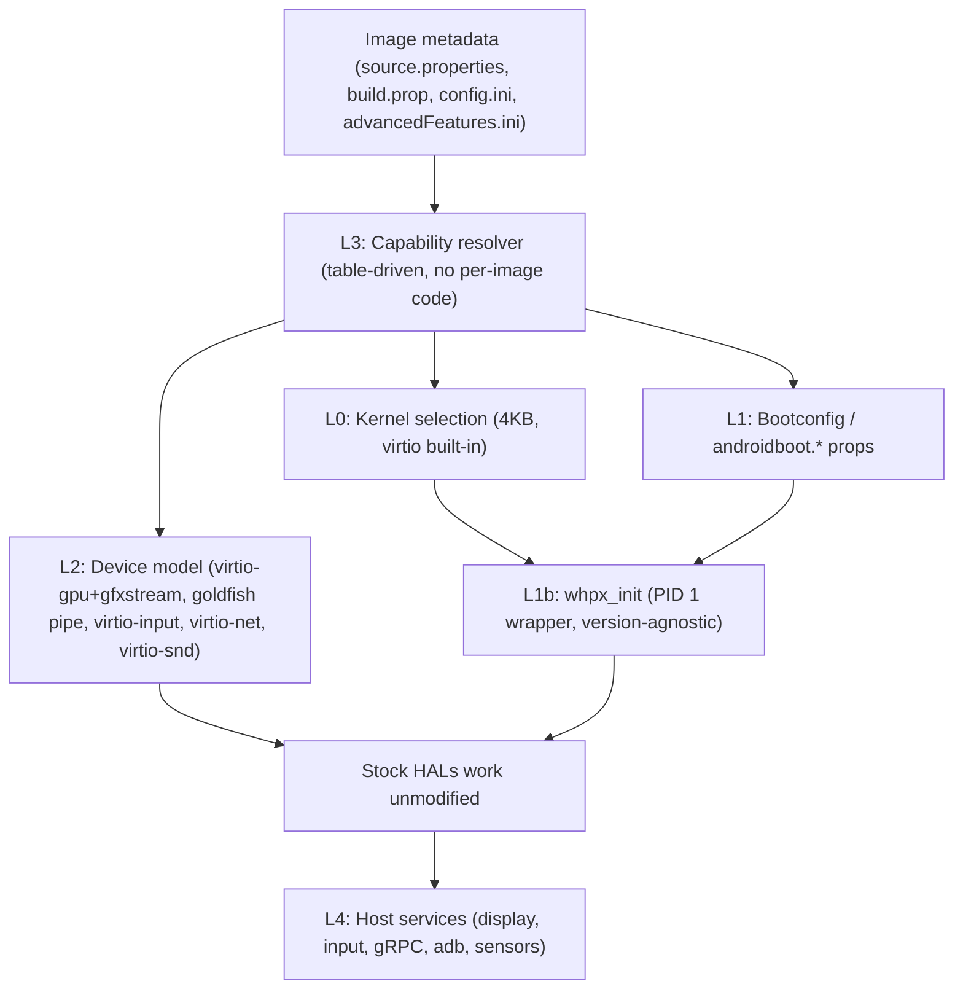

# Generic Zero-Patch Approach — Any Android Version, Any Device (Windows ARM64 WHPX)

## 1. The core principle

> **Never modify the guest. Make the platform look like the hardware the stock image already expects.**

Every per-emulator fix so far has the same cause. The guest is stock, but the virtual hardware under it is incomplete. Then guest binaries get patched to cope with what's missing:

| Missing on the host / QEMU side | Guest-side workaround we used (version-locked) |
|---|---|
| No goldfish pipe / address-space device | Binary-patched `libqemupipe`, `libOpenglSystemCommon`, `libEGL_emulation`, allocator, mapper at fixed offsets |
| No virtio-gpu + gfxstream | `gfx_forwarder` + TCP redirect + patched EGL |
| No DHCP-managed ethernet visible to ConnectivityService | Static IP, `ip rule … lookup main`, `DefaultNetworkAgent` jar |
| No battery / sensors / modem services | tmpfs `/sys/class/power_supply`, stubbed HALs |
| Fixed kernel ↔ ramdisk module coupling | Per-API module directories |

Patches at fixed offsets only work for the one build they were made against. Real devices behave the same way at the hardware level in every version, because Android's HALs talk to stable interfaces: virtio, goldfish pipe, DRM, and input event devices. **If we put the fix at the hardware level, every image works, including ones that don't exist yet.**

Guest-side intervention is allowed only through interfaces that are **ABI-stable across all versions**:
- the kernel
- the bootconfig / kernel command line
- PID 1 wrapping
- SELinux CIL text
- standard properties

All of these already work generically in `whpx_init`.

---

## 2. Layered architecture

### L0 — Kernel: remove the module coupling entirely
- Build **one universal 4KB kernel** (latest Android LTS: 6.6 or 6.12) with **every virtio driver and the network failover drivers built in (`=y`)**: blk, net, pci, mmio, console, gpu, input, snd, vsock, rng, dma_buf. That covers both the WHPX 4KB constraint and Android's minimum-kernel checks (e.g. `NetBpfLoad` needs 5.15.136+ / 6.1.57+).
- In the ramdisk, **replace `modules.load` with an empty list**. First-stage init then has nothing to load, so `module_layout` / vermagic mismatches can't happen on any API level.
- Android allows a newer kernel under older userspace (it checks minimums, not maximums). Keep `kernel_p7_permissive` only as a fallback if an old image turns out to reject the newer kernel.
- 16KB images (`ps16k`) still run on a 4KB kernel, since their userspace is 16KB-aligned. Only the ext4 block size of the generated disks follows the image's page size.

### L1 — Boot parameters derived from metadata, plus a generic PID 1 shim
- Generate `androidboot.*` exactly as the official emulator does, from a **table keyed on capabilities, not on API level or device**:
  - `hardware=ranchu`
  - `hardware.gltransport` (`virtio-gpu-asg` / `virtio-gpu-pipe`)
  - `hardware.egl` (`emulation` or `angle`)
  - `hardware.vulkan`
  - `opengles.version`
  - `lcd.density`
  - `serialno`
  - `boot_devices`
  - `qemu.*` props
- `whpx_init` (already working, version-agnostic):
  - SELinux CIL permissive overlay, applied before policy load, with no image modification
  - persistent `/proc` handle across switch_root
  - adbd supervision without restarts
  - adb key deployment
  - serial root shell
- The network workarounds in `whpx_init` (static IP, `pref 5000` main-table rule) become **fallbacks**. They're only used if the L2 network device isn't adopted by Android.

### L2 — Device model: the real fix (replaces every patched guest library)
| Device | What stock images expect | Covers |
|---|---|---|
| **virtio-gpu with gfxstream capset (ASG + pipe transports)** | Stock `libEGL_emulation`, minigbm allocator/mapper, `composer3-service.ranchu` (DRM) talk to `/dev/dri/*` | GLES/Vulkan on API 30–37+, all form factors |
| **virtio-gpu 2D + guest SwiftShader/ANGLE** (fallback) | `androidboot.hardware.egl=angle`, `vulkan=pastel` | Any image, if host 3D is unavailable (slower, but needs no patches) |
| **goldfish pipe** (or the same protocol over virtio-vsock where the image supports it) | `qemud:*` services: sensors, battery, GNSS, fingerprint, modem, clipboard | Stable protocol since API 26 → all versions |
| **virtio-input** (multitouch, keyboard, rotary, D-pad) | Stock evdev | Phone, tablet, foldable, Wear (rotary), TV (D-pad) |
| **virtio-net + DHCP (slirp)** managed by Android's own EthernetTracker | Stock connectivity stack | Internet/DNS with no agent or route hacks |
| **virtio-snd** (API 33+) / goldfish audio | Stock audio HAL | Audio |
| **virtio-blk** | Stock fstab | Storage |

**This is the main engineering item.** We already run a gfxstream renderer on the host (`GfxServer`). What's missing is exposing it to the guest as a **virtio-gpu device** instead of through a TCP side channel. That can be either:
- built into our QEMU, or
- a separate host backend process (vhost-user style).

Done once, it serves every image, because the guest side (gfxstream guest stack + minigbm + DRM composer) ships unmodified in every ranchu image.

### L3 — Capability resolver (no per-emulator code)
Read the image's own metadata and probe its vendor partition once (cache per image hash) to decide:
- **Kernel requirement**: minimum version from API level / `NetBpfLoad` rules.
- **Graphics transport**: does the vendor ship minigbm + the DRM composer? → `virtio-gpu-asg`; only the goldfish allocator → `virtio-gpu-pipe`; neither working → SwiftShader fallback.
- **Page size**: `ps16k` / `16kb` tag → disk block size.
- **Form factor**: tag `android-wear` / `android-tv` / `android-automotive` / default → display shape, input map (rotary, D-pad, touch).
- **Display**: `hw.lcd.width/height/density` from `config.ini`.

Everything is driven by declarative tables. A new Android version or device needs a table row at most, never a new patch.

### L4 — Host services (unchanged, form-factor aware)
Display streaming, input injection (laptop keys → D-pad on TV, scroll → rotary on Wear), gRPC for Android Studio, ADB.

---

## 3. What gets deleted once L0/L2 are in place
- `patched/`, `patched_p33/`, `patch_guest_gfx.py` (fixed-offset binary patches)
- Graphics/HAL bind mounts in `start_android_ui.sh`, `framework_patched.jar`, `mapper3.so`
- `gfx_forwarder`, `default_net_agent.jar`, `run_net_agent.sh`, power-supply tmpfs stubs
- `modules_whpx_5_15/`, `modules_whpx_6_1/` and per-API module selection in `prepare_whpx_initrd.py`
- API-specific branches in `WhpxEmulatorBridge.java` (`android-33` checks, etc.)

What stays: `whpx_init` (generic) and `prepare_whpx_initrd.py`, reduced to two jobs: wrap `/init` and blank `modules.load`.

---

## 4. Verification: automatic compatibility matrix
A headless runner boots **every installed system image** (and any new one as soon as the SDK Manager downloads it) and checks:
1. `adb` comes online, `sys.boot_completed=1`
2. `surfaceflinger` is stable and the screenshot isn't black
3. Network: DNS + HTTPS from the guest
4. Input: tap / key / rotary / D-pad round-trip
5. Results are recorded as a per-image pass/fail table. Any failure points to a missing **device or table row**, never a guest patch.

---

## 5. Suggested order of work
| Phase | Deliverable | Removes |
|---|---|---|
| 1 | Universal built-in-virtio 4KB kernel + empty `modules.load` | Per-API kernels and module sets |
| 2 | Metadata-driven bootconfig generator (L1/L3 tables) | Hard-coded cmdline and API checks |
| 3 | virtio-gpu + gfxstream device wired to the existing host renderer, with SwiftShader fallback | All patched graphics libraries and `gfx_forwarder` |
| 4 | virtio-net with DHCP adopted by Android; goldfish-pipe `qemud` services (battery, sensors) | Net agent, route hacks, sysfs stubs |
| 5 | virtio-input form-factor maps; virtio-snd | Input daemon special cases |
| 6 | Compatibility-matrix runner | Manual testing |

> [!IMPORTANT]
> Phase 3 is the critical path and the main risk. It depends on whether our QEMU build can host a virtio-gpu device backed by the gfxstream renderer on Windows ARM64. Check that first, before committing to the rest of the schedule.
